<a href="https://crawlcove.com/download?utm_source=github&utm_medium=readme&utm_campaign=redirect-chain-checker"></a>

# redirect-chain-checker

A **redirect chain checker** CLI: follow every hop of a URL's redirects, see each status code and Location, and find out when a chain, loop, HTTPS downgrade, meta refresh or redirect to a 404 is costing you crawl budget and link equity. Exit code 1 in CI when it matters.

Prefer a browser? The same check runs at [crawlcove.com/tools/redirect-checker](https://crawlcove.com/tools/redirect-checker?utm_source=github&utm_medium=redirect-chain-checker).



*Recorded from a real run against [seo-test-site](https://github.com/CrawlCove/seo-test-site), a public site full of planted SEO problems that you can test against too.*

## Quick start

```sh
npx github:CrawlCove/redirect-chain-checker https://crawlcove.github.io/seo-test-site/blog https://crawlcove.github.io/seo-test-site/blog/moved.html http://crawlcove.github.io/seo-test-site/
```

```
https://crawlcove.github.io/seo-test-site/blog
  301 → https://crawlcove.github.io/seo-test-site/blog/  (255 ms)
  ↳ 200  (49 ms)
  1 redirect → https://crawlcove.github.io/seo-test-site/blog/ (200)
  ✓ no findings

https://crawlcove.github.io/seo-test-site/blog/moved.html
  200  (18 ms)
  0 redirects
  ! meta-refresh: https://crawlcove.github.io/seo-test-site/blog/moved.html redirects again with a meta refresh (0s → https://crawlcove.github.io/seo-test-site/blog/choosing-a-wick.html); search engines treat this as a weak redirect

http://crawlcove.github.io/seo-test-site/
  301 → https://crawlcove.github.io/seo-test-site/  (31 ms)
  ↳ 200  (17 ms)
  1 redirect → https://crawlcove.github.io/seo-test-site/ (200)
  ! http-to-https: http://crawlcove.github.io/seo-test-site/ is reached over HTTP first; link to https://crawlcove.github.io/seo-test-site/ directly

1 of 3 URL(s) have failing findings (chain, loop, too-many-hops, https-to-http, meta-refresh, redirect-to-error, fetch-error).
```

## Install

```sh
# one-off, nothing installed (Node 18+):
npx github:CrawlCove/redirect-chain-checker https://example.com/old-page

# global command, from the release tarball:
npm install -g https://github.com/CrawlCove/redirect-chain-checker/archive/refs/tags/v1.0.0.tar.gz
redirect-chain-checker --version
```

(The tarball form is deliberate: a global `github:` install on npm 10 leaves a dangling symlink. The npm package is coming.)

## Usage

```sh
redirect-chain-checker <url...> [options]
redirect-chain-checker --file urls.txt      # one URL per line, # comments allowed

Options:
  --max-hops <n>       give up after this many redirects (default 10)
  --timeout <ms>       per-request timeout (default 10000)
  --json               JSON output for scripts
  --fail-on <codes>    comma-separated finding codes that set exit code 1, or "none"
                       (default: chain,loop,too-many-hops,https-to-http,meta-refresh,redirect-to-error,fetch-error)
```

Example:

```
$ redirect-chain-checker http://example.com/old
http://example.com/old
  301 → https://example.com/old  (120 ms)
  ↳ 301 → https://www.example.com/old  (95 ms)
  ↳ 302 → https://www.example.com/new  (88 ms)
  ↳ 200  (140 ms)
  3 redirects → https://www.example.com/new (200)
  ! chain: 3 redirects in a row — point http://example.com/old straight at https://www.example.com/new
  ! http-to-https: http://example.com/old is reached over HTTP first; link to https://example.com/old directly
  ! temporary-redirect: https://www.example.com/old uses a temporary 302; use 301/308 if the move is permanent
```

Scheme-less URLs are tried over HTTPS. Exit codes: `0` clean (or only non-gated findings), `1` a gated finding, `2` usage error.

## What each finding means, and the fix

| Finding | Why it matters | Fix |
|---|---|---|
| `chain` | Every extra hop costs crawlers time and leaks a little link equity; Google follows at most ~10 and may give up sooner. | Point the first URL straight at the final one (and update internal links to the final URL). |
| `loop` | The URL never resolves, so users see a browser error and crawlers drop it. | Find the rule that sends the final URL back to the start. |
| `too-many-hops` | Same as a chain, but past the point a crawler will follow. | As `chain`. |
| `https-to-http` | A secure page redirecting to an insecure one drops the padlock and can be flagged as mixed content. | Make the target HTTPS. |
| `http-to-https` | Fine as a safety net, but every internal link that starts on HTTP costs a hop. | Link to the HTTPS URL directly; keep the redirect for old links. |
| `temporary-redirect` | 302/307 tell search engines the old URL may return, so ranking signals may stay on the old URL. | Use 301 (or 308) for a permanent move. |
| `meta-refresh` | A `<meta http-equiv="refresh">` after the HTTP redirects finish is a slow, weak redirect that some crawlers ignore. | Replace with a server-side 301. |
| `redirect-to-error` | The chain ends on a 4xx/5xx, which is a slow way of losing the page. | Redirect to the live equivalent, or return 410 directly. |
| `fetch-error` | Something in the chain did not respond (DNS, TLS, timeout). | Check the host in the last hop shown. |

## Works with CrawlCove

This checks the URLs you give it. [Crawl Cove](https://crawlcove.com/?utm_source=github&utm_medium=redirect-chain-checker), the desktop SEO crawler, finds every redirect chain across a whole site, including the internal links that point at the start of each chain, which is what you actually have to fix.

## Related tools

<!-- related:start, kept in step by CrawlCove/.github scripts/related.mjs -->
| Repo | What it does |
|---|---|
| [seo-crawler-cli](https://github.com/CrawlCove/seo-crawler-cli) | Crawl a site from a script or CI. Checks status codes, redirect chains, titles, meta descriptions, H1s, canonicals, noindex and broken links, and fails the build on regressions. |
| [seo-audit-action](https://github.com/CrawlCove/seo-audit-action) | Crawl a staging or preview URL on every pull request. Fails the check on broken links, missing titles, noindex and redirect chains, with the details as a PR comment. |
| [seo-mcp-server](https://github.com/CrawlCove/seo-mcp-server) | Crawl a site, list SEO issues, inspect pages and find broken links from inside Claude, Cursor and other AI assistants. |
| [claude-seo-plugin](https://github.com/CrawlCove/claude-seo-plugin) | Seven SEO skills for Claude Code backed by a real site crawl: audits, broken links, redirects, titles and fixes, from a chat. |
| [seo-chrome-extension](https://github.com/CrawlCove/seo-chrome-extension) | On-page SEO checker with an AI visibility report: which AI crawlers can read the page, snippet blocks, llms.txt and extractability. Nothing leaves the browser. |
| [xml-sitemap-validator](https://github.com/CrawlCove/xml-sitemap-validator) | Check a sitemap or sitemap index against the sitemaps.org protocol and search engine limits. Flags bad URLs, lastmod dates and cross-host entries. |
| [robots-txt-tester](https://github.com/CrawlCove/robots-txt-tester) | Fetch and lint a robots.txt, test which URLs each crawler may fetch and see the deciding line. Fails deploys that block the site. |
| [hreflang-checker](https://github.com/CrawlCove/hreflang-checker) | Validate the hreflang tags on a page or across a whole XML sitemap, including self-reference, x-default and return tags. |
| [schema-markup-validator](https://github.com/CrawlCove/schema-markup-validator) | Check every schema.org node on a page against the required and recommended properties for rich results. |
| [seo-test-site](https://github.com/CrawlCove/seo-test-site) | A deliberately broken SEO test site with every planted problem and its expected finding listed, for testing any SEO crawler. |
| [seo-crawl-export-spec](https://github.com/CrawlCove/seo-crawl-export-spec) | An open format for site crawl data: JSON Schema and CSV column reference, with a real sample export and a validator script. |
| [seo-crawl-export-js](https://github.com/CrawlCove/seo-crawl-export-js) | Load, query and convert site crawl data in JavaScript and TypeScript, with typed pages, issues by type and status filters. |
| [screaming-frog-export-converter](https://github.com/CrawlCove/screaming-frog-export-converter) | Turn an SEO Spider internal_all.csv into the open JSON crawl export format, with a report of which columns carried over. |
| [seo-audit-google-sheets](https://github.com/CrawlCove/seo-audit-google-sheets) | An Apps Script add-on that turns a site crawl export into an audit workbook: pages, issues by type, pages by status and title and meta flags. |
| [wordpress-seo-connector](https://github.com/CrawlCove/wordpress-seo-connector) | Bulk-apply fixes from the Crawl Cove desktop crawler to Yoast SEO, Rank Math, SEOPress or AIOSEO, with a change log and one-click revert. |
<!-- related:end -->

## License

MIT, see [LICENSE](LICENSE).
